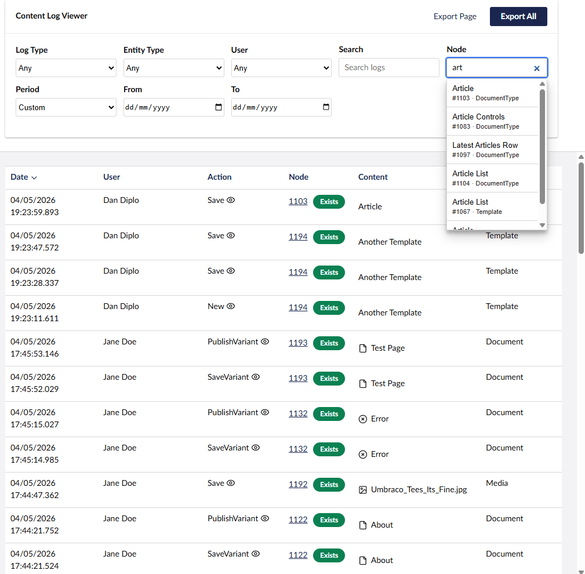
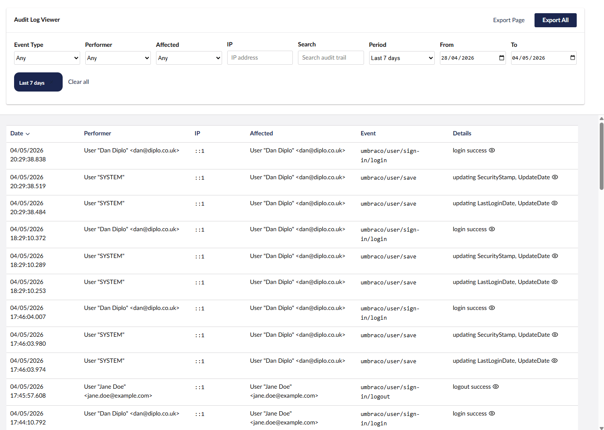

# Diplo Audit Log Viewer for Umbraco 17

View, search, filter, sort, and export Umbraco content log and audit trail data from the Settings section.

This version targets **Umbraco 17** and **.NET 10**. It uses the modern Umbraco backoffice extension model with Lit, TypeScript, Vite, `umbraco-package.json`, Management API controllers, and static web assets.

## Features

- Content Log viewer for `umbracoLog`.
- Audit Trail viewer for `umbracoAudit`.
- Server-side pagination, filtering, sorting, and searching.
- Date preset filters such as Today, Yesterday, Last 7 days, Last 30 days, This month, and Previous month.
- Friendly node search with autocomplete and direct numeric id fallback.
- Contextual side-workspace links for supported logged entities.
- Expanded row detail drawers for technical values such as parameters, entity type, node key, user keys, IP address, and event details.
- CSV export for current page or all matching rows.
- Optional appsettings switch to hide export controls.

## Screenshots





## Configuration

```json
{
  "AuditLogViewer": {
    "DisableExport": false
  }
}
```

Set `DisableExport` to `true` to remove CSV export controls from the backoffice UI.

## Compatibility

- Umbraco CMS 17
- .NET 10

Older Umbraco versions should use the corresponding older package releases.

## Umbraco Marketplace

https://marketplace.umbraco.com/package/diplo.auditlogviewer
