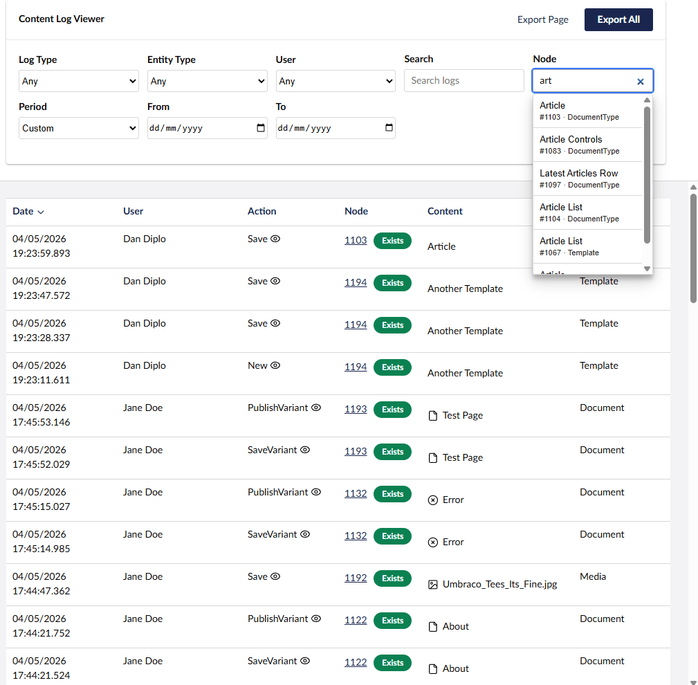
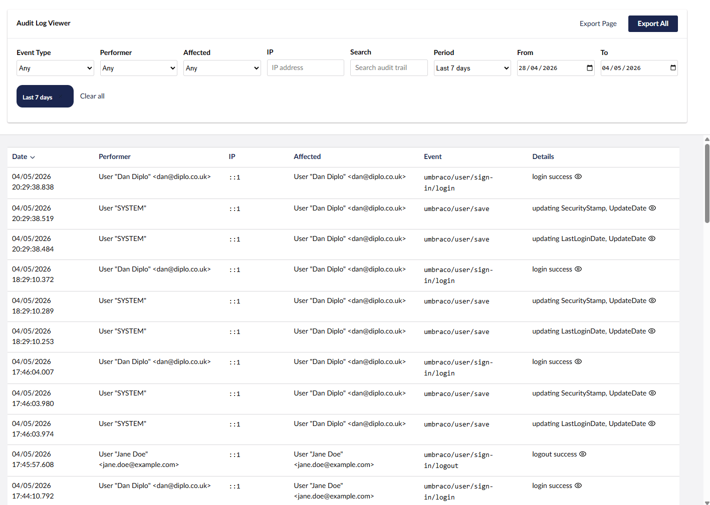

# Diplo Audit Log Viewer for Umbraco 17

**Diplo Audit Log Viewer** lets Umbraco backoffice users inspect and search the data stored in Umbraco's `umbracoLog` and `umbracoAudit` tables.

This version targets **Umbraco 17** and **.NET 10**. The legacy AngularJS/tree implementation has been replaced with a Lit + TypeScript backoffice extension registered via `umbraco-package.json`.

## Backoffice

The package appears in the **Settings** section as **Audit Log Viewer** with two workspaces:

- **Content Log**
- **Audit Trail**

Both views use server-side paging, searching, sorting, and filtering.

## Screenshots





## Content Log

The Content Log view shows records from `umbracoLog`.

Features include:

- Filter by log action, entity type, user, node, search term, date range, and date presets.
- Search nodes by name with autocomplete, while still allowing direct numeric node id entry.
- Open logged entities in an Umbraco side workspace where supported.
- Contextual node opening for documents, media, members, document types, data types, templates, and partial views.
- Display whether a logged node still exists.
- Expanded row details for comments, parameters, entity type, node key, document type, and status.
- Optional CSV export of the current page or all matching rows.

## Audit Trail

The Audit Trail view shows records from `umbracoAudit`.

Features include:

- Filter by event type, performer, affected user, performer IP, search term, date range, and date presets.
- Expanded row details for performer, affected user, stable user keys, IP address, event type, and event details.
- Optional CSV export of the current page or all matching rows.

## Configuration

CSV export is enabled by default. It can be hidden from the backoffice UI with appsettings:

```json
{
  "AuditLogViewer": {
    "DisableExport": false
  }
}
```

Set `DisableExport` to `true` to remove the export buttons from both views.

## API

The backoffice uses Umbraco's Management API under:

`/umbraco/management/api/v1/audit-log-viewer`

Endpoints:

- `GET /settings`
- `GET /content-log`
- `GET /content-log/types`
- `GET /content-log/users`
- `GET /content-log/entity-types`
- `GET /content-log/nodes`
- `GET /audit-trail`
- `GET /audit-trail/event-types`
- `GET /audit-trail/users`

All endpoints require Settings-section backoffice access.

## Development

The package project is `Diplo.AuditLogViewer` and the local Umbraco 17 test bed is `Diplo.AuditLogViewer.Testsite`.

Useful commands:

```powershell
dotnet build Diplo.AuditLogViewer\Diplo.AuditLogViewer.csproj /p:UseAppHost=false
```

```powershell
cd Diplo.AuditLogViewer\Client
npm run type-check
npm run build
```

The client builds to:

`Diplo.AuditLogViewer/wwwroot/App_Plugins/DiploAuditLogViewer`

## Notes

- This package intentionally queries Umbraco's own log tables directly.
- Sort fields are whitelisted server-side.
- Date `To` filters are treated inclusively by adding one day server-side.
- Built assets are shipped via static web assets; legacy `package.manifest` and AngularJS files are not used.

## Umbraco Marketplace

https://marketplace.umbraco.com/package/diplo.auditlogviewer

